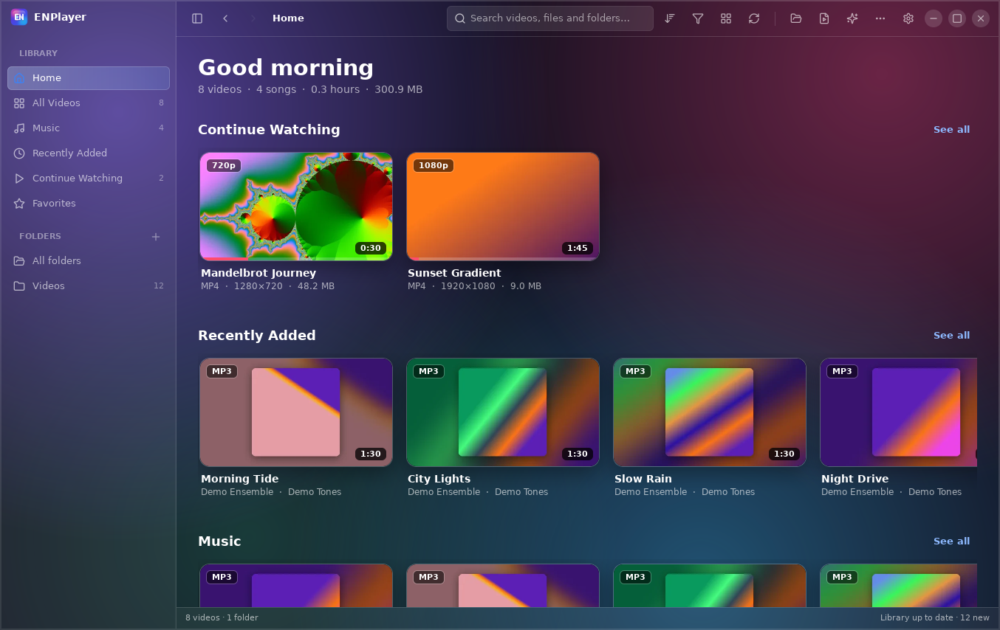
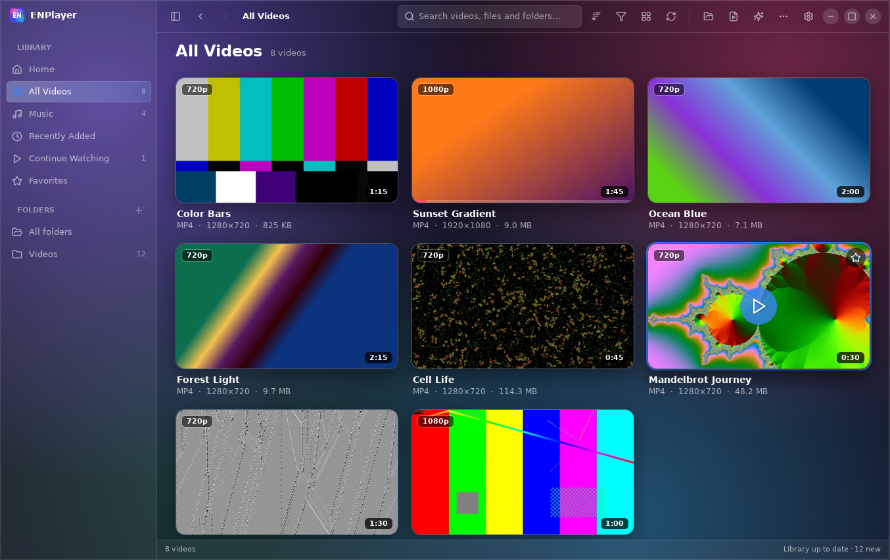
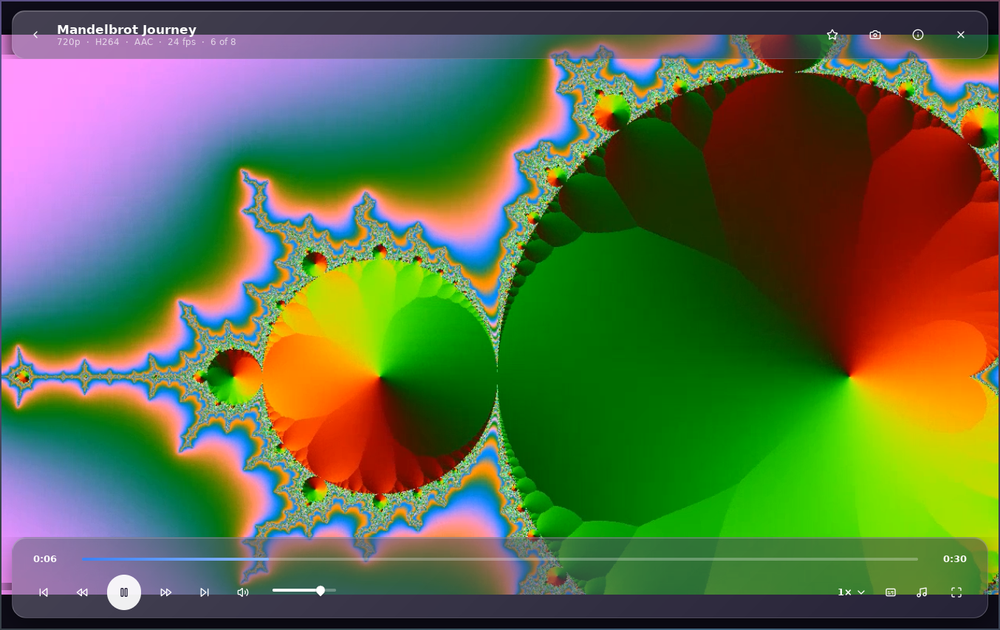
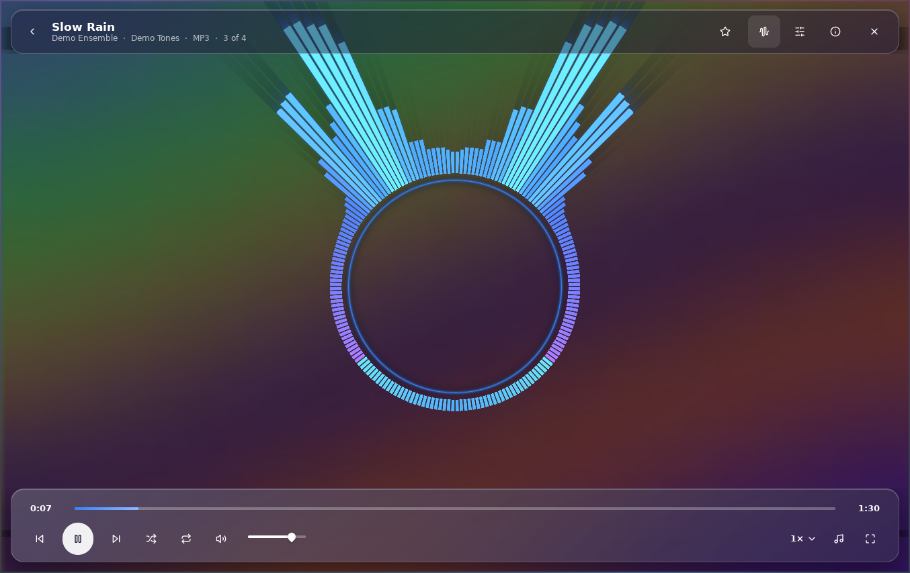
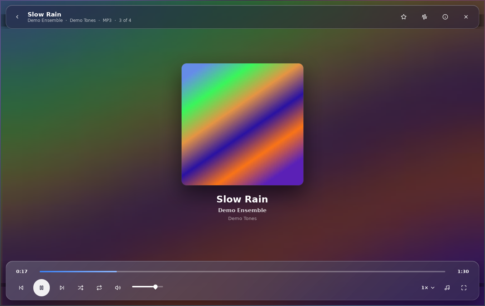
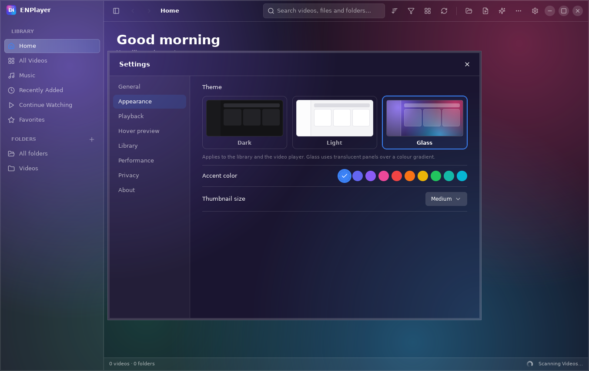

# ENPlayer user guide

ENPlayer is a video library and music player for Windows 10/11 and Ubuntu. It finds the videos in
your folders, shows a live preview when you rest the pointer on one, and plays almost any file.

## Getting started

1. Open ENPlayer. Your **Videos** folder is added and scanned automatically.
2. To add another folder, click **+** or press `Ctrl+N`.
3. Rest the pointer on a video to preview it, and click it to play.

To play a single file, press `Ctrl+O` or drag it onto the window. Other files in the same folder
become its playlist. On Windows you can also right-click a video and choose **Open with → ENPlayer**.

## Your library

* **Home** shows Continue Watching, Recently Added, Favorites and All Videos.
* **Search** (`Ctrl+F`) matches titles, file names and folders.
* **Filter** by resolution, format, duration or favorites, and **sort** by date added, name,
  duration, size or resolution.
* New files appear by themselves while ENPlayer is open. Press `F5` to rescan, and `F9` to show or
  hide the sidebar.
* Files that cannot be read stay in the list with a label, so you can see which ones have a problem.

## Hover preview

A preview plays from the original file, muted, after a short delay. It stops when the pointer
leaves the card. Change the delay, length, volume and resolution in **Settings → Hover preview**.

## Watching videos

Controls hide by themselves while a video plays. Move the mouse to bring them back. From the
controls you can seek, change the volume (up to 130%) and speed (0.25× to 3×), choose an audio or
subtitle track, and load a subtitle file.

ENPlayer remembers where you stopped, so you can resume from **Continue Watching**.

| Key | Action |
|-----|--------|
| `Space` / `K` | Play or pause |
| `←` / `→` | Seek 5 seconds |
| `Shift+←` / `Shift+→` | Seek 1 second |
| `Ctrl+←` / `Ctrl+→` | Seek 1 minute |
| `J` / `L` | Seek 10 seconds |
| `0` – `9` | Jump to 0% – 90% |
| `Home` | Restart |
| `,` / `.` | Previous or next frame |
| `[` / `]` | Slower or faster |
| `Backspace` | Normal speed |
| `N` / `P` | Next or previous video |
| `↑` / `↓` | Volume |
| `M` | Mute |
| `A` | Next audio track |
| `S` | Next subtitle |
| `V` | Show or hide subtitles |
| `F` / `F11` / double-click | Full screen |
| `Esc` | Exit full screen or close the player |
| `I` | Statistics |
| `Ctrl+S` | Screenshot |

## Music

Audio files appear in the **Music** section, with their tags and cover art. It supports MP3, FLAC,
M4A/AAC, OGG, Opus, WAV, WMA, AIFF, APE and WavPack. Use shuffle and repeat from the Now Playing
screen. The mini player keeps music going while you browse your library.

To turn the music library off, go to **Settings → Library → Music library**.

### Visualizer

ENPlayer has 50 visualizer presets that react to the music. You can change the speed, sensitivity,
colors and other options in the visualizer controls.

| Key | Action |
|-----|--------|
| `V` | Visualizer on or off |
| `,` / `.` | Previous or next preset |
| `R` | Random preset |
| `F` | Full-screen visualizer |

## Other library shortcuts

| Key | Action |
|-----|--------|
| `Ctrl+O` | Open a file |
| `Ctrl+N` | Add a folder |
| `Ctrl+F` | Search |
| `F5` | Rescan the library |
| `F9` | Show or hide the sidebar |
| `Ctrl+,` | Settings |
| `Ctrl+?` | Show all shortcuts |
| `Ctrl+Q` | Quit |

## Settings

Open **Settings** with `Ctrl+,`.

* **General**: startup view, sidebar, and update checks
* **Appearance**: Dark, Light or Glass theme, and thumbnail size
* **Playback**: resume, default volume and speed, and hardware decoding
* **Hover preview**: delay, length, volume and resolution
* **Library**: subfolders, and video and audio formats
* **Performance**: thumbnail cache
* **Privacy**: clear watch history or thumbnails

## Always on top

Click the pin icon in the toolbar or the player, or go to **Settings → General → Always on top**,
to keep ENPlayer above other windows. On Ubuntu with Wayland, restart ENPlayer once after turning
it on.

## Updates

ENPlayer checks for a new version once a day. When one is available, click **Update now**. Your
library and settings are kept. To check yourself, go to **Settings → General → Check now**.

## Removing ENPlayer

* **Windows**: Settings → Apps → ENPlayer → Uninstall
* **Ubuntu**: run `sudo apt remove enplayer`

Your video and music files are not deleted.

## Getting help

Report a problem on [GitHub](https://github.com/mestiaque/enplayer/issues) or email
<info@mestiaque.com>.
